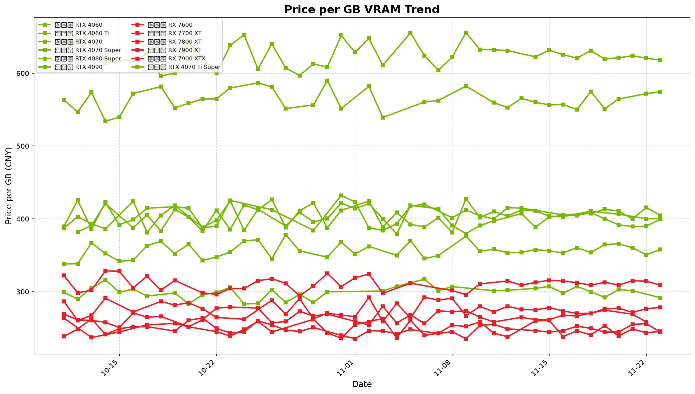

# 📊 京东 GPU 显卡价格监控

自动追踪京东显卡价格变化，每日更新两次。

## 📈 产品价格

| 产品 | 显存 | 当前价格 | 有货 |
|------|------|----------|------|
| 七彩虹 RTX 4060 | 8GB | ¥2458.15 | ✅ |
| 七彩虹 RTX 4060 Ti | 8GB | ¥3219.30 | ✅ |
| 七彩虹 RTX 4070 | 12GB | ¥4273.42 | ✅ |
| 七彩虹 RTX 4070 Super | 12GB | - | ❌ |
| 七彩虹 RTX 4070 Ti Super | 16GB | ¥6459.48 | ✅ |
| 七彩虹 RTX 4080 Super | 16GB | ¥8902.41 | ✅ |
| 七彩虹 RTX 4090 | 24GB | ¥15161.02 | ✅ |
| 蓝宝石 RX 7600 | 8GB | ¥2085.07 | ✅ |
| 蓝宝石 RX 7700 XT | 12GB | ¥3139.42 | ✅ |
| 蓝宝石 RX 7800 XT | 16GB | ¥3911.65 | ✅ |
| 蓝宝石 RX 7900 XT | 20GB | ¥5563.34 | ✅ |
| 蓝宝石 RX 7900 XTX | 24GB | ¥7576.13 | ✅ |

---

## 📊 价格趋势图

### NVIDIA 显卡价格对比

### AMD 显卡价格对比

### 每GB显存价格趋势

---

## 🔄 自动更新

每天北京时间 10:00 和 20:00 自动更新价格。

## 📁 数据格式

历史数据存储在 `data/YYYY-MM-DD.json` 文件中。

---

*数据仅供参考，以京东实际价格为准*